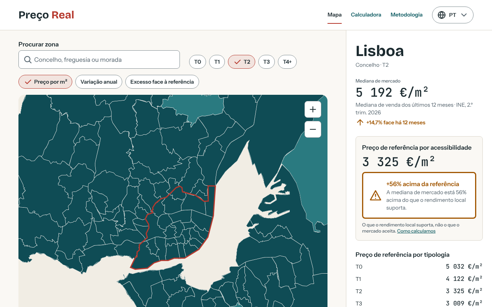
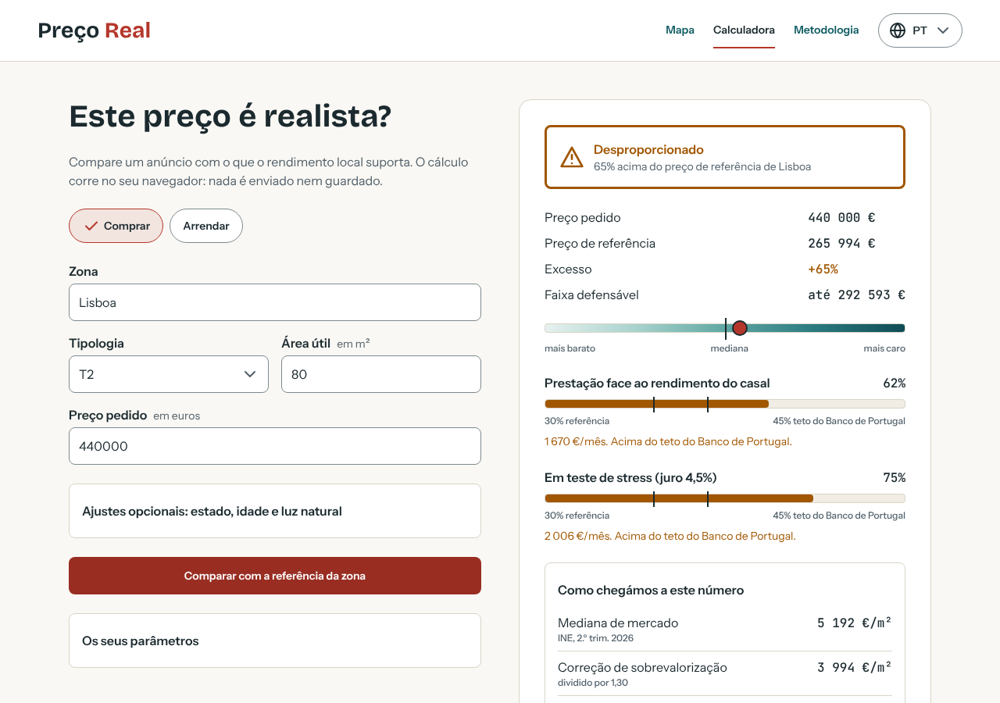
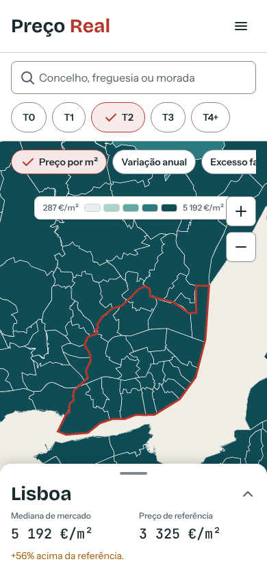

# Preço Real

**Quanto custa, de facto, uma casa que o rendimento local consegue pagar?**
Um serviço público e gratuito que põe lado a lado o que o mercado pede e o que as famílias da zona conseguem suportar, com a matemática à vista, para tornar visíveis os preços desproporcionados.

<p align="center">
  
</p>

## A ideia

Em Portugal, os preços das casas subiram mais de 16% em 2025 e continuam a subir, muito acima dos salários. As médias escondem o problema, e quem compra ou arrenda não tem um termo de comparação independente.

O Preço Real faz duas perguntas simples a cada zona e a cada anúncio:

1. **O que diz o mercado?** A mediana de venda do INE (factual).
2. **O que consegue pagar quem vive ali?** Um **preço de referência por acessibilidade** (normativo), calculado a partir do rendimento mediano local, com o esforço máximo que o Banco de Portugal considera razoável.

A diferença entre as duas é o **excesso**. Sem opinião: com fórmulas, parâmetros e fontes que se podem ver, editar e discutir.

> O modelo ignora a procura **de propósito**. Mede o que é suportável, não o que o mercado aceita, e diz isso em todas as páginas.

## O que já faz

| | |
|---|---|
| **Mapa** | Concelhos e freguesias, por preço por m², variação anual ou excesso face à referência; filtro por tipologia, pesquisa e partilha por link. |
| **Calculadora** | Compra ou renda: introduza zona, área e preço do anúncio e veja o veredicto (dentro da tolerância, acima do razoável, inflacionado, desproporcionado), o esforço da prestação (com teste de stress) e a decomposição do número. O cálculo corre no seu navegador. |
| **Metodologia** | Todas as fórmulas, coeficientes (estado, idade, tamanho), hipóteses assinaladas como tal e limitações. |
| **PT e EN** | Português de Portugal (por defeito) e inglês, no endereço (`/` e `/en/`). |
| **Privacidade** | Sem contas, sem cookies de publicidade, sem enviar o que escreve. Fontes tipográficas alojadas no próprio site. |

<p align="center">
  
  
</p>

## Como se calcula (em três linhas)

```
S1 = mediana INE da zona ÷ 1,30                  (mercado corrigido da sobrevalorização)
S2 = preço que um casal com dois rendimentos medianos paga com 30% de esforço, 3% de juro, 30 anos, 90% de financiamento
Referência = min(mediana, média de S1 e S2) × área × coeficientes do imóvel
```

Os limiares de leitura (10%, 20% e 50% acima da referência) não são limites legais. A página diz-o. Documento completo, com fontes e decisões: [`docs/modelo-preco-referencia.md`](docs/modelo-preco-referencia.md).

## Dados e fontes

- **INE:** mediana de venda (12 meses), rendimento bruto declarado por sujeito passivo, renda mediana de novos contratos.
- **DGT:** Carta Administrativa Oficial de Portugal (CAOP 2025).
- **Banco de Portugal:** limite de esforço de 45%.
- Os valores em falta nunca são preenchidos: onde o INE suprime a mediana, o site diz "dados insuficientes".

## Arquitetura

```
data-pipeline/     INE + DGT → zonas.json, concelhos.geojson, freguesias.geojson (Node + Python)
packages/model/    modelo de preço de referência: funções puras e testadas
packages/ui/       Design System em código: tokens, 40+ componentes React, catálogos PT/EN
web/               site estático (Vite, React, MapLibre); só importa @preco-real/ui e @preco-real/model
docs/              modelo, backlog, decisões a rever
```

Processo: todo o componente visual é desenhado primeiro no Design System (Claude Design) e só depois exportado para código; todo o texto passa por *string keys* em ficheiros de idioma; nada do que o utilizador escreve sai do navegador.

## Correr localmente

```bash
npm ci
npm run web:dev          # site em http://localhost:5173
npm run ui:test          # componentes e i18n
npm run model:test       # modelo
npm test -w @preco-real/data-pipeline -w @preco-real/web
```

Atualizar dados (requer acesso ao INE e à DGT): ver [`data-pipeline/README.md`](data-pipeline/README.md).

## Estado e transparência

Versão **0.x, em preparação**. O modelo precisa de revisão por um avaliador imobiliário ou economista antes do lançamento, e os parâmetros marcados *hipótese do projeto* ainda não têm fonte oficial. As decisões em aberto estão em [`docs/backlog/decisoes-a-rever.md`](docs/backlog/decisoes-a-rever.md).

**Aviso:** o preço de referência é uma estimativa por acessibilidade. Não é aconselhamento financeiro nem jurídico, nem avaliação oficial.

## Licença

Código visível, **todos os direitos reservados**: pode ler, estudar e usar o site; copiar, alojar ou criar obras derivadas exige autorização escrita. Os dados oficiais mantêm os termos das suas fontes. Detalhes em [`LICENSE`](LICENSE).
